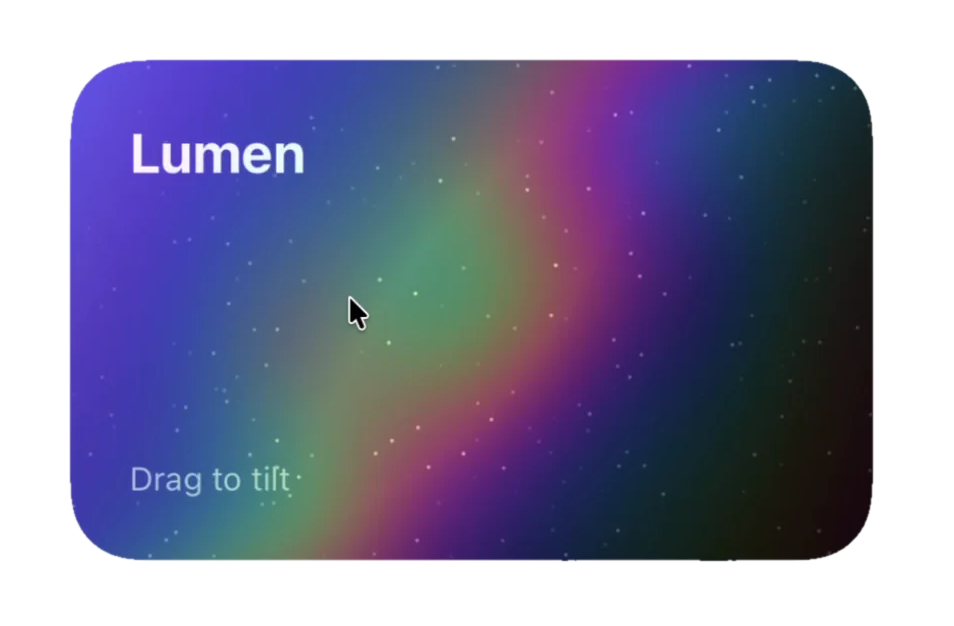
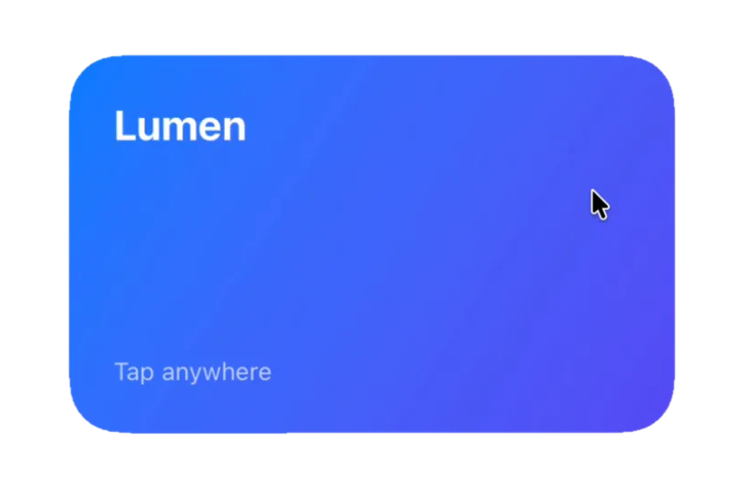

I've been building iOS apps for six years. Swift and SwiftUI are home, but I don't stay in my lane: when a feature needs an endpoint, a dashboard or an Android build, I'd rather write it than wait for it.

I like products that feel effortless, and I've learned that getting there is mostly unglamorous work: cutting features, fixing the animation nobody asked about, and shipping before it feels ready.

#### What I'm building

  

**[Lumen](https://github.com/kareemalnajjar99/Lumen)** is a Swift package of Metal shader effects for SwiftUI, each one a single line to add: a holographic foil that follows your finger and the tilt of your phone, ripples that spread from every tap, and a transition that pours a view in like liquid. Version 1.0 is out and open source.

#### Find me

[LinkedIn](https://www.linkedin.com/in/kareemalnajjar) · [kareemalnajjar.com](https://www.kareemalnajjar.com)
